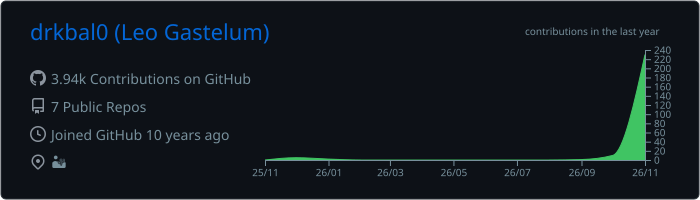
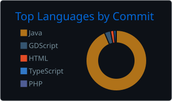
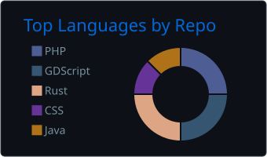

  <!-- HEADER DINÁMICO MINIMALISTA -->
  

  

    <i>A passionate full-stack developer, tech & innovation enthusiast from Sonora, México 🌵</i> 
    <i>Always looking for ways to architect, optimize, and automate everything around me.</i>
  

  <!-- REDES SOCIALES -->
  

    
    
    
  

 

### ⚡ Core Stack & Infrastructure

  **Languages & Frameworks**
  

    
  

  **Systems, Cloud, DB & GameDev**
  

    
  

  **AI, Data & Enterprise Integrations**
  

    
    
    
    
    
    
    
  

 

### 📊 GitHub Analytics & Historical Activity (Since 2015)

  <!-- PANORAMA HISTÓRICO GENERAL DE COMMITS (COMPACTO) -->
  

    

  <!-- GRÁFICAS DE PASTEL: LENGUAJES POR COMMIT + LENGUAJES POR REPO (PÚBLICOS Y PRIVADOS) -->
  
  

    

  <!-- DESGLOSE DE TODOS LOS LENGUAJES USADOS (PÚBLICOS + PRIVADOS) -->
  

